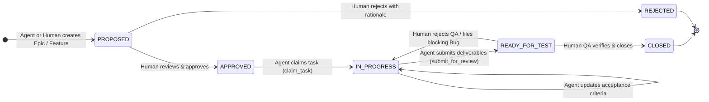

# Workmesh MVP Scope Specification

**Version:** 1.0.0-mvp  
**Status:** Approved for Implementation  
**Architecture Model:** Passive System of Record (MCP + Web)  
**Target Delivery:** Fast-path MVP dogfoodable via Cursor / Claude Code / Antigravity  

---

## 1. Executive Summary & Vision

Workmesh is an **Agent-First Ticket Management System** that bridges autonomous AI coding agents and human engineering managers. 

In modern software development, agents work in IDEs without situational context or explicit human guardrails, while human issue trackers (Jira, Linear) are built exclusively for humans and lack agent protocols. Workmesh solves this by exposing ticket lifecycle management over the **Model Context Protocol (MCP)** while providing humans with an intuitive, real-time **Web Kanban & Approval Console**.

---

## 2. Definitive Scope Boundaries

### In-Scope (MVP Day 1)
| Capability | Scope Decision | Rationale |
| :--- | :--- | :--- |
| **Operational Role** | **Passive MCP System of Record** | Workmesh does **not** run or spawn LLMs. External coding agents (Cursor, Claude Code, Antigravity) connect via MCP. |
| **Authentication & Tenancy** | **Pure Auth-Less** | Zero login walls or user management for MVP. Maximizes velocity to get the core agent loop working immediately. Commercial multi-tenancy deferred to v1.1. |
| **Human Gate** | **Strict Approval & Sign-Off** | Agents can only create `PROPOSED` tickets and move items to `READY_FOR_TEST`. Only humans can transition to `APPROVED`, `REJECTED`, or `CLOSED`. |
| **MCP Transports** | **Dual Transport (Stdio + HTTP/SSE)** | Stdio for local IDE tools (`claude_desktop_config.json`, Cursor MCP), HTTP/SSE on the Hono server for remote agents and web hooks. |
| **Bug Tracking** | **Bidirectional** | Both humans (during QA) and agents (when encountering blockers/broken tests) can report bugs linked to features or epics. |
| **Streamlined Hand-off** | **Criteria Verification** | Transitioning a feature to `READY_FOR_TEST` marks acceptance criteria as completed, with an optional notes field. No mandatory Git/PR plumbing. |
| **Real-time Sync** | **Server-Sent Events (SSE)** | Hono streams ticket mutations live to the Next.js Kanban board so users see agent claims and submissions without refreshing. |
| **Observability** | **Explicit `activity_logs` Table** | Every state change, claim, and submission is recorded with actor type (`HUMAN` vs `AGENT`), actor identifier, and timestamp. |
| **UI Experience** | **Board + Detail Slide-over** | Interactive Kanban board with columns for each lifecycle state, plus a slide-over drawer to inspect criteria, audit trail, and deliverables. |

### Out-of-Scope (Deferred to v1.1 / Commercial)
- **User Authentication & RBAC**: No Clerk/NextAuth/Supabase Auth logins, no team permissions or organization invites.
- **Agent Orchestrator / Runner**: No container sandboxes, Docker runners, or direct OpenAI/Anthropic execution loops inside Workmesh.
- **GitHub / GitLab Native Apps**: No automated PR merging or GitHub bot comments (agents provide Git URLs directly through MCP tools).
- **Billing / Metering / Invoicing**: No commercial subscription tiers or agent compute tracking.
- **Time Tracking & Sprint Estimations**: No story points, velocity charts, or burn-down diagrams.

---

## 3. Core Lifecycle State Machine



### State Transition Authority Matrix
| Transition | Allowed Actor | Required Payload |
| :--- | :--- | :--- |
| `[None]` $\rightarrow$ `PROPOSED` | **Human or Agent** | Title, Description, Acceptance Criteria (for Features) |
| `PROPOSED` $\rightarrow$ `APPROVED` | **Human Only** | Optional approval note |
| `PROPOSED` $\rightarrow$ `REJECTED` | **Human Only** | Rejection reason |
| `APPROVED` $\rightarrow$ `IN_PROGRESS` | **Agent** (or Human) | Ticket ID |
| `IN_PROGRESS` $\rightarrow$ `READY_FOR_TEST` | **Agent** | Updated criteria checklist, optional notes |
| `READY_FOR_TEST` $\rightarrow$ `CLOSED` | **Human Only** | Final sign-off |
| Any $\rightarrow$ Bug Filed | **Human or Agent** | Title, Description, Reproduction steps, Linked Feature/Epic |

---

## 4. MCP Agent Tool Suite (The Agent Interface)

Instead of exposing dangerous, unconstrained CRUD operations, Workmesh exposes **workflow-oriented tools** that enforce the state machine:

### 1. `get_project_context`
- **Purpose:** Agent reads the active project, description, prefix key, and high-level roadmap.
- **Inputs:** `projectId` (integer, optional if default is selected).
- **Returns:** Project summary and active epics list.

### 2. `propose_epic`
- **Purpose:** Agent analyzes a broad objective and decomposes it into an Epic.
- **Inputs:** `title`, `description`, `priority` (`LOW` | `MEDIUM` | `HIGH` | `CRITICAL`).
- **Result:** Created Epic in `PROPOSED` status.

### 3. `propose_feature`
- **Purpose:** Agent creates an actionable feature unit under an existing Epic.
- **Inputs:** `epicId`, `title`, `description`, `priority`, `acceptanceCriteria` (array of string items).
- **Result:** Created Feature in `PROPOSED` status.

### 4. `list_actionable_tasks`
- **Purpose:** Agent queries work ready to be claimed or fixes needed.
- **Inputs:** `status` (defaults to `APPROVED`), optional `epicId`.
- **Returns:** Formatted list of features and open bugs ready for execution.

### 5. `claim_task`
- **Purpose:** Agent claims an `APPROVED` feature or `OPEN` bug to signal active development.
- **Inputs:** `ticketType` (`FEATURE` | `BUG`), `ticketId`.
- **Result:** Status moves to `IN_PROGRESS`, records activity log, broadcasts SSE event.

### 6. `submit_for_review`
- **Purpose:** Agent hands off completed work to the human tester.
- **Inputs:** 
  - `featureId`: integer
  - `completedCriteria`: array of boolean or completed checklist indices
  - `notes`: string (optional completion notes)
- **Result:** Feature status moves to `READY_FOR_TEST`, logs activity, triggers human review.

### 7. `report_bug`
- **Purpose:** Human or Agent reports a defect linked to a Feature, Epic, or standalone.
- **Inputs:** `title`, `description`, `reproductionSteps` (optional), `priority`, `featureId` (optional), `epicId` (optional).
- **Result:** Creates Bug ticket in `OPEN` status.

### 8. `resolve_bug`
- **Purpose:** Agent reports that a bug fix has been implemented and tested.
- **Inputs:** `bugId`, `notes` (optional).
- **Result:** Bug moves to `RESOLVED`.

---

## 5. Database Schema Delta

To keep the MVP lean and fast, our existing tables in `packages/db/src/schema` ([`projects.ts`](file:///d:/Projects/Workmesh/packages/db/src/schema/projects.ts), [`epics.ts`](file:///d:/Projects/Workmesh/packages/db/src/schema/epics.ts), [`features.ts`](file:///d:/Projects/Workmesh/packages/db/src/schema/features.ts), [`bugs.ts`](file:///d:/Projects/Workmesh/packages/db/src/schema/bugs.ts)) are **already complete and sufficient**! We do not need extra columns for branch, PR, or assigned agents.

The only new table to introduce is `activity_logs`:

### New `activity_logs` table (`packages/db/src/schema/activity_logs.ts`)
Tracks an immutable audit trail of actions:
- `id`: `serial().primaryKey()`
- `projectId`: `integer().references(() => projects.id, { onDelete: "cascade" })`
- `entityType`: `varchar({ length: 20 })` (`"PROJECT"` | `"EPIC"` | `"FEATURE"` | `"BUG"`)
- `entityId`: `integer().notNull()`
- `action`: `varchar({ length: 50 })`.notNull() (e.g., `"PROPOSED"`, `"APPROVED"`, `"CLAIMED"`, `"SUBMITTED_FOR_REVIEW"`, `"REJECTED"`, `"CLOSED"`)
- `details`: `jsonb()` (optional notes, diffs, criteria updates)
- `createdAt`: `timestamp().defaultNow().notNull()`

---

## 6. Real-Time Architecture (SSE)

```text
[ External Agent (IDE) ]
           │
           │ (MCP: get_project_context / claim_task / submit_for_review)
           ▼
[ packages/mcp-server ] ───┐
                           ▼
               [ @workmesh/db (Domain Services & Transactions) ]
                           ▲
[ apps/api (Hono) ] ───────┘
           │
           │ (Server-Sent Events: /api/projects/:id/stream)
           ▼
[ apps/web (Next.js) ] (Live updates Kanban board & Activity drawer)
```

- Endpoint: `GET /api/projects/:id/stream`
- Event types:
  - `ticket:created`: When epics/features/bugs are proposed or filed.
  - `ticket:updated`: When status transitions, claims, or criteria changes occur.
  - `activity:new`: Appends directly into the activity log stream.

---

## 7. Web UI Deliverables (Next.js)

1. **Top Bar**: Project selector, "New Project" modal, SSE Live connection status pulse indicator (`● Connected`).
2. **Kanban Board**: 5 dynamic columns:
   - **Proposed** (with quick "Approve" / "Reject" action buttons)
   - **Approved** (backlog waiting for agents)
   - **In Progress** (actively claimed tasks)
   - **Ready for Test** (highlighted cards with review button)
   - **Closed** (completed features)
3. **Detail Slide-Over Drawer**:
   - Title, project ticket number (e.g. `WM-4`), description
   - Interactive Acceptance Criteria checklist
   - Linked Bugs section with "+ File Bug" modal
   - Activity History timeline
